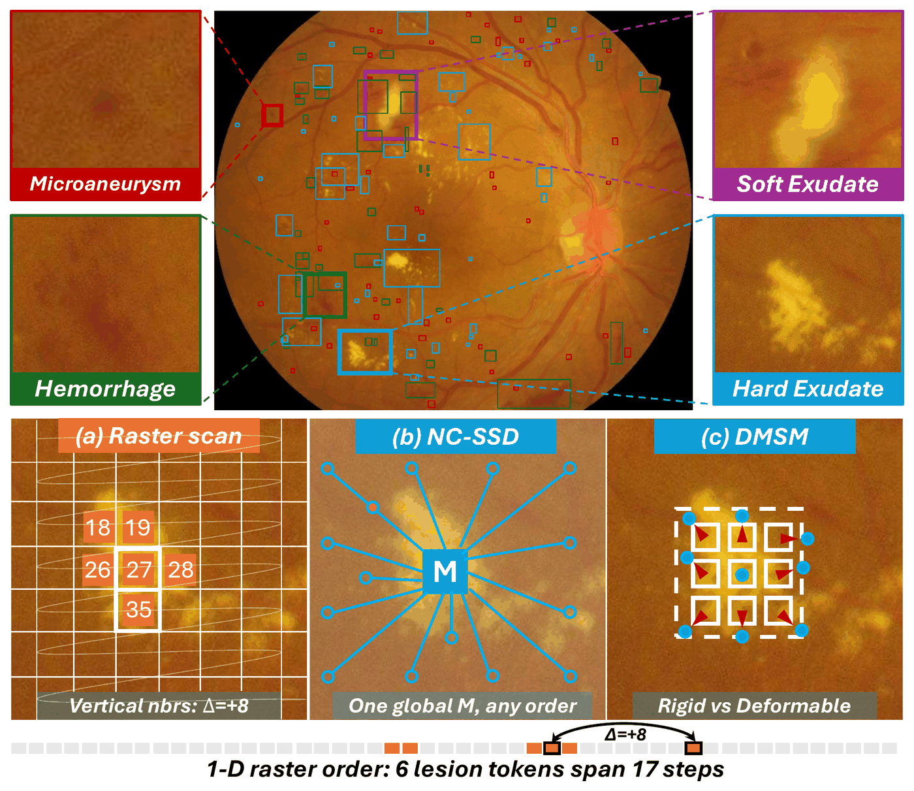
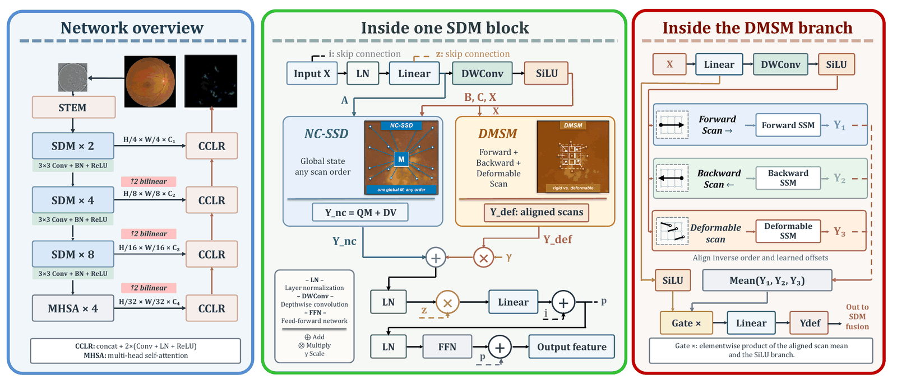
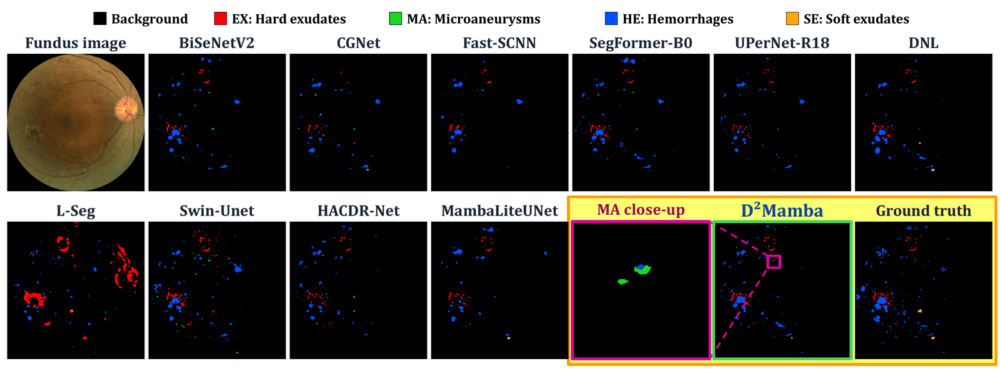
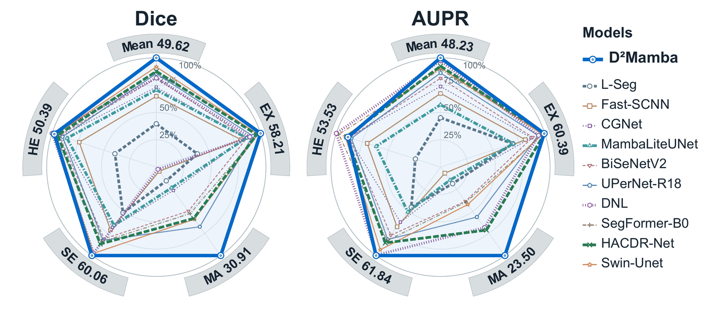

<div align="center">

# D²Mamba

### Seeing the Small: Deformable Duality Mamba for Retinal Lesion Segmentation

**Chang Yu · Siqing Li · Yuanchen Liu · Zhenyu Bu · Luming Yang<sup>✉</sup> · Alper Yilmaz**

The Ohio State University, Columbus, OH, USA

*ISBI 2027 (under review)*

[](https://pytorch.org/)
[](https://github.com/open-mmlab/mmsegmentation)
[](LICENSE)

<sub>Third-party components keep their original licenses. See <a href="THIRD_PARTY_LICENSES.md">THIRD_PARTY_LICENSES.md</a>.</sub>



</div>

**D²Mamba** segments the four diabetic-retinopathy lesions in fundus images: hard exudates (EX), microaneurysms (MA), soft exudates (SE), and hemorrhages (HE). It couples **non-causal state space duality (NC-SSD)**, which aggregates global context without a fixed scan order, with a **deformation-aware multi-scan mechanism (DMSM)**, which adapts sampling to lesion shape.

## 📑 Contents

- [Highlights](#-highlights)
- [Method in brief](#-method-in-brief)
- [Results](#-results)
- [Installation](#-installation)
- [Data preparation](#-data-preparation)
- [Training and evaluation](#-training-and-evaluation)
- [Project structure](#-project-structure)
- [Acknowledgments](#-acknowledgments)
- [Citation](#-citation)
- [License](#-license)
- [Contact](#-contact)

## ✨ Highlights

- 🔍 **Global context + shape-adaptive scanning.** The SDM block couples NC-SSD with deformable Mamba scanning (DMSM) to model the spatial organization of lesion regions.
- 📈 **Highest macro scores on DDR five-fold:** **33.87%** mIoU (2.99 points above Swin-Unet), **49.62%** mDice, and **48.23%** mAUPR among ten re-implemented baselines trained under an identical protocol.
- 🎯 **Largest gain on microaneurysms:** **18.29%** IoU and **30.91%** Dice, against UPerNet-R18's 11.70% and 20.85%; **23.50%** AUPR against HACDR-Net's 16.74%.

## 🧠 Method in brief

<p align="center">
  
</p>

A convolutional stem is followed by three **SDM** stages with 2, 4, and 8 blocks at widths 64, 128, and 256. The fourth stage contains four multi-head self-attention (MHSA) blocks at width 512. A progressive **CCLR** decoder fuses upsampled decoder features with encoder skips, and a third-stage auxiliary head supervises training.

Each **SDM block** has two branches:

- **NC-SSD** computes a global state summary over all positions, without a causal mask or a fixed scan order, and projects it back to every position.
- **DMSM** predicts offsets on the 2-D grid, samples features bilinearly, and scans them forward, backward, and in a deformable order set by learned scores. The three aligned streams are averaged, gated, and projected.

The two outputs are fused per channel (Eq. 2 in the paper), with a learned channel scale γ that controls the deformable contribution:

```math
Y = Y_{nc} + \gamma \odot Y_{def}, \qquad \gamma_c^{(0)} = 10^{-3}
```

## 📊 Results

### DDR five-fold comparison

IoU (%) is reported as the mean ± population standard deviation over the five held-out test folds. The macro mean excludes background. **Bold** marks the best value in each column.

| Model | Type | mIoU | EX | MA | SE | HE |
| --- | :---: | ---: | ---: | ---: | ---: | ---: |
| L-Seg | CNN | 11.30 ± 1.60 | 13.01 ± 2.71 | 2.57 ± 3.63 | 18.50 ± 3.69 | 11.14 ± 1.55 |
| Fast-SCNN | CNN | 20.52 ± 1.40 | 31.03 ± 1.43 | 0.73 ± 0.50 | 27.15 ± 1.52 | 23.18 ± 5.74 |
| CGNet | CNN | 23.48 ± 1.98 | 33.47 ± 2.68 | 4.28 ± 1.54 | 25.78 ± 3.46 | 30.39 ± 6.41 |
| BiSeNetV2 | CNN | 26.35 ± 1.49 | 34.02 ± 2.73 | 8.35 ± 1.32 | 32.23 ± 3.24 | 30.81 ± 5.02 |
| UPerNet-R18 | CNN | 27.85 ± 1.93 | 36.90 ± 3.25 | 11.70 ± 2.62 | 33.13 ± 2.18 | 29.68 ± 6.91 |
| DNL | CNN | 27.88 ± 2.74 | 35.49 ± 4.78 | 0.39 ± 0.46 | 41.39 ± 3.41 | **34.23 ± 8.30** |
| HACDR-Net | CNN | 28.97 ± 1.33 | 39.01 ± 1.87 | 9.86 ± 1.34 | 35.44 ± 3.80 | 31.56 ± 5.47 |
| SegFormer-B0 | Transformer | 28.84 ± 1.18 | 39.82 ± 2.47 | 8.88 ± 1.82 | 33.98 ± 3.50 | 32.68 ± 5.37 |
| Swin-Unet | Transformer | 30.88 ± 1.77 | 39.61 ± 2.03 | 10.04 ± 0.66 | 41.53 ± 3.77 | 32.36 ± 4.14 |
| MambaLiteUNet | Mamba | 22.94 ± 2.23 | 33.86 ± 5.17 | 3.82 ± 2.45 | 26.31 ± 13.83 | 27.76 ± 4.95 |
| **D²Mamba (ours)** | Mamba | **33.87 ± 2.78** | **41.14 ± 3.47** | **18.29 ± 0.75** | **43.09 ± 4.96** | 32.98 ± 5.76 |

| Macro metric | D²Mamba | Strongest baseline |
| --- | ---: | --- |
| mDice | **49.62** | 45.57 (Swin-Unet) |
| mAUPR | **48.23** | 46.98 (DNL) |

> [!NOTE]
> These results use reconstructed image-level five-fold splits of DDR, which are released in [`splits/`](splits), rather than the official DDR split. Compare them only with results obtained under this protocol.

<details>
<summary><b>Qualitative example and class-wise radar plots</b></summary>

<p align="center"></p>

Qualitative comparison on DDR image 007-6148-300: fundus image, baseline predictions, D²Mamba, and ground truth. The magenta box marks the region enlarged in the MA close-up.

<p align="center"></p>

Five-fold mean Dice and AUPR for the four lesion classes and their macro mean. Each grey outer band gives the highest score (%) on that axis; the rings show 25% to 100% of that score.

</details>

### Ablation (DDR fold 1)

| Metric (%) | VSSD (NC-SSD only) | D²Mamba | Δ |
| --- | ---: | ---: | ---: |
| mIoU | 36.09 | **37.36** | +1.27 |
| mDice | 51.95 | **53.37** | +1.43 |
| mAUPR | 51.74 | **52.07** | +0.33 |
| EX IoU | 44.61 | **46.78** | +2.16 |
| MA IoU | 16.99 | **19.60** | +2.60 |
| SE IoU | 42.76 | **46.88** | +4.12 |
| HE IoU | **39.99** | 36.20 | −3.79 |

<sub>This is a single-fold test comparison. Δ is computed before rounding, as in the paper.</sub>

## ⚙️ Installation

Requirements: Linux and an NVIDIA GPU. The code was developed with PyTorch 2.1 + CUDA 11.8, MMCV 2.1, MMSegmentation 1.2.2, and MMEngine 0.10.

```bash
git clone <this-repo-url> D2Mamba && cd D2Mamba

pip install torch==2.1.2 torchvision==0.16.2 --index-url https://download.pytorch.org/whl/cu118
pip install -U openmim && mim install "mmcv==2.1.0"
pip install -r requirements.txt

# selective-scan CUDA kernel for the DMSM branch
cd kernels/selective_scan && pip install . --no-build-isolation && cd ../..
```

> [!TIP]
> NC-SSD is pure PyTorch, so it needs neither Triton nor `mamba-ssm`. If the bundled kernel fails to build, run `pip install mamba-ssm --no-build-isolation` instead; the DMSM branch falls back to it automatically.

## 🗂️ Data preparation

Download DDR from its official release; the images are not redistributed here. Then convert it to the MMSeg layout, with one PNG label map per image:

```text
D2Mamba/
├── data/DDR_mmseg/
│   ├── img_dir/{train,valid,test}/*.jpg
│   └── ann_dir/{train_four,valid_four,test_four}/*.png
└── splits/                     # released fold manifests
    ├── fold{0..4}_train.csv
    ├── fold{0..4}_val.csv
    └── fold{0..4}_test.csv
```

Labels are `0` background, `1` EX, `2` MA, `3` SE, and `4` HE. Manifest paths are relative to `data/DDR_mmseg`, which can also be a symlink (`ln -s /path/to/DDR_mmseg data/DDR_mmseg`).

<details>
<summary><b>Evaluation protocol and per-fold image counts</b></summary>

| Setting | Value |
| --- | --- |
| Data | 757 lesion-annotated DDR images, image-level five-fold splits |
| Input | 1028 × 1028; black-border removal, Gaussian background correction, ImageNet normalization |
| Augmentation | Random resize [0.5, 2.0], crop, flip, and photometric distortion |
| Optimization | AdamW, batch size 4, lr 6 × 10⁻⁵, weight decay 0.01 |
| Schedule | 100,000 updates, 1,500 warm-up updates, then polynomial decay; validation every 2,000 updates |
| Selection | Validation mDice selects the checkpoint; test scores are averaged equally across folds |
| Metrics | IoU and Dice from class-wise confusion counts pooled within each test fold; AUPR from softmax scores with 1,000 histogram bins |

| Fold | Train | Val | Test |
| --- | ---: | ---: | ---: |
| 0 | 453 | 152 | 152 |
| 1 | 454 | 151 | 152 |
| 2 | 455 | 151 | 151 |
| 3 | 455 | 151 | 151 |
| 4 | 454 | 152 | 151 |

</details>

## 🚀 Training and evaluation

**Train one fold:**

```bash
python tools/train.py configs/d2mamba/d2mamba_ddr_fold0.py
bash tools/dist_train.sh configs/d2mamba/d2mamba_ddr_fold0.py 4   # 4 GPUs
```

Outputs are written to `work_dirs/d2mamba_ddr_fold0/`. They include the best validation-mDice checkpoint (`best_mDice_iter_*.pth`) and `train_history.xlsx`.

**Evaluate a checkpoint:**

```bash
python tools/test.py configs/d2mamba/d2mamba_ddr_fold0.py /path/to/checkpoint.pth \
  --split test --strict-checkpoint --work-dir work_dirs/eval_fold0
```

`--strict-checkpoint` rejects missing, unexpected, or shape-mismatched weights. Always evaluate a checkpoint with **its own fold config**.

<details>
<summary><b>Run all five folds and aggregate</b></summary>

```bash
for i in 0 1 2 3 4; do
  python tools/train.py configs/d2mamba/d2mamba_ddr_fold${i}.py
done
python tools/aggregate_5fold.py --phase test --metric mDice
```

The aggregation script picks each fold's test row at its best validation mDice. It writes the mean and population variance to `work_dirs/fivefold_test_summary.xlsx`.

Run the unit tests with `python -m unittest discover -s tests -v`.

</details>

## 🧩 Project structure

<details>
<summary><b>Expand</b></summary>

```text
D2Mamba/
├── configs/
│   ├── _base_/d2mamba_ddr_1028.py     # shared model / data / schedule
│   └── d2mamba/d2mamba_ddr_fold{0..4}.py
├── d2mamba/
│   ├── models/
│   │   ├── vssd_backbone.py           # SDM block: NC-SSD mixer + γ fusion, encoder
│   │   ├── defmamba.py                # DMSM deformable multi-scan
│   │   ├── mamba_util.py              # stem, patch merging, MLP
│   │   ├── mm_backbone.py             # D2MambaBackbone (MMSeg registry)
│   │   └── cclr_head.py               # CCLR decoder
│   ├── datasets/  transforms/  losses/  metrics/
│   ├── hooks/                         # per-validation train_history.xlsx
│   └── evaluation/                    # strict checkpoint checks
├── kernels/selective_scan/            # optional CUDA kernel (core variant)
├── splits/                            # DDR five-fold manifests
├── tools/                             # train / test / dist / aggregate
├── tests/
└── docs/figures/
```

Some internal class names, such as `Backbone_VMAMBA2` and `Mamba2`, keep their upstream names so that state-dict keys stay compatible.

</details>

## 🙏 Acknowledgments

This code builds on [VSSD](https://github.com/YuHengsss/VSSD), [DefMamba](https://github.com/leiyeliu/DefMamba), [VMamba](https://github.com/MzeroMiko/VMamba), [Mamba](https://github.com/state-spaces/mamba), and [MMSegmentation](https://github.com/open-mmlab/mmsegmentation). We thank their authors and the creators of the DDR dataset. [THIRD_PARTY_LICENSES.md](THIRD_PARTY_LICENSES.md) lists the provenance of the adapted files.

## 📝 Citation

```bibtex
@misc{yu2027d2mamba,
  title  = {Seeing the Small: Deformable Duality Mamba for Retinal Lesion Segmentation},
  author = {Yu, Chang and Li, Siqing and Liu, Yuanchen and Bu, Zhenyu and Yang, Luming and Yilmaz, Alper},
  year   = {2026},
  note   = {Under review at IEEE International Symposium on Biomedical Imaging (ISBI) 2027}
}
```

## 📄 License

The D²Mamba code is released under the [Apache License 2.0](LICENSE). Files adapted from third-party projects keep their original terms; see [NOTICE](NOTICE) and [THIRD_PARTY_LICENSES.md](THIRD_PARTY_LICENSES.md).

## 📬 Contact

For questions, please open an issue or contact **Luming Yang** at [yang.7670@osu.edu](mailto:yang.7670@osu.edu).
